<p align="center"></p>

<h1 align="center">Mammography Segmentation &amp; Positioning</h1>

<p align="center">
  Segmentation of breast tissue, pectoral muscle and nipple · positioning assessment with the posterior nipple line
  (PNL) · a review web application · a training and evaluation framework · a MedSAM2 annotation toolkit ·
  segmentation labels for VinDr-Mammo
</p>

<p align="center">
  <a href="https://github.com/enescanerkan/mammography-segmentation/actions/workflows/ci.yml"></a>
  
  
  
</p>

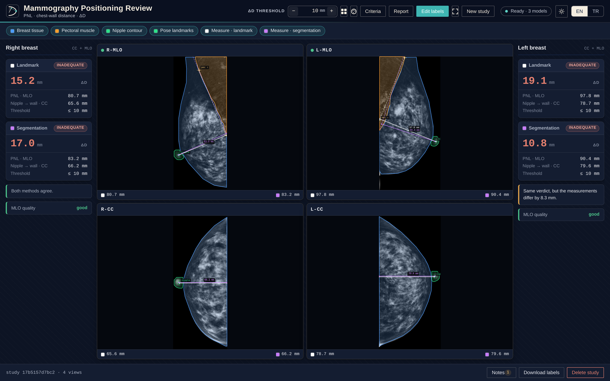

<sub>The review app on a public CMMD four-view study. For each breast, ΔD is measured on two independent routes,
the landmark model and the segmentation masks. Here both routes rate both breasts inadequate, and for the left
breast the app notes that the two measurements differ by 8.3 mm.</sub>

## Project structure

```
mammography-segmentation/
├── src/breast_seg/
│   ├── apps/positioning/      review web application (FastAPI + build-free browser client)
│   ├── inference/             landmark engine, lazy model loading
│   ├── imaging/               DICOM reading, preprocessing recipes (wavelet640, baseline640), display renders
│   ├── positioning/           measures, criteria, scoring, reports, label edits
│   ├── geometry.py            PNL and chest-wall geometry, pectoral line rule
│   ├── registry.py            model registry (configs/models.yaml)
│   ├── datasets/              VinDr-Mammo dataset builder: YOLO, semantic and nnU-Net layouts, audit
│   ├── training/              one Trainer per model family, k-fold runner
│   ├── evaluation/            Dice / IoU, landmark and distance errors, nipple and PNL rules, statistics
│   ├── benchmark/             end-to-end runtime benchmark
│   └── cli.py                 the breast-seg command
├── configs/
│   ├── models.yaml            models of the app: weights, preprocessing recipe, output type
│   ├── app.example.yaml       app settings
│   ├── paths.example.yaml     local paths of training and evaluation
│   ├── train/                 one YAML per model (inheritance from _*.yaml fragments)
│   ├── cv/                    10-fold cross-validation of the four models
│   └── benchmark/             runtime benchmark configuration and held-out pair list
├── labels/
│   ├── vindr-mammo/           breast, pectoral muscle and nipple polygons of 2,926 VinDr-Mammo images
│   └── external/              EMBED and CMMD test sets: radiologist landmarks (EMBED also polygons)
├── tools/
│   ├── annotation/            PyQt5 annotation toolkit (MedSAM2, manual, positioning)
│   └── figures/               the script that draws the architecture figures
├── packaging/                 Windows desktop build (PyInstaller) and the weights manifest
├── docs/                      APP, MODELS, TRAINING, EVALUATION, BENCHMARK; figures
├── tests/                     unit and API tests (CPU, no weights needed)
├── Dockerfile, docker-compose.yml
└── pyproject.toml, constraints.txt
```

---

## Table of contents

- [Project structure](#project-structure)
- [Clinical background](#clinical-background)
- [How the measurement works](#how-the-measurement-works)
  - [MLO-only quality](#mlo-only-quality)
- [What is in the repository](#what-is-in-the-repository)
- [Quick start](#quick-start)
- [Labels](#labels)
- [Models](#models)
- [Training and evaluation](#training-and-evaluation)
- [Annotation toolkit](#annotation-toolkit)
- [Development](#development)
- [Notes and license](#notes-and-license)

---

## Clinical background

Breast tissue left outside the image cannot be read. That is why every mammography quality-control programme
checks positioning. The standard check compares the two screening views of one breast with the
**posterior nipple line (PNL)**:

| View | PNL |
|---|---|
| **MLO** (mediolateral oblique) | from the nipple, perpendicular to the anterior edge of the pectoral muscle |
| **CC** (craniocaudal) | from the nipple straight back to the chest-wall edge of the image |

When both views include the same amount of posterior tissue, the two lengths agree. The criterion of the ACR
*Mammography Quality Control Manual* (1999; Bassett et al., *Radiology* 1993) is that the CC PNL lies within 1 cm
of the MLO PNL:

> **ΔD = |PNL<sub>MLO</sub> − D<sub>CC</sub>| ≤ 10 mm → adequate**, otherwise inadequate (the threshold is a setting).

| View | Landmarks | Count |
|---|---|---|
| MLO | nipple, pectoral top, pectoral bottom | 3 |
| CC | nipple | 1 |

Distances are converted to millimetres with the DICOM pixel spacing (`ImagerPixelSpacing`, else `PixelSpacing`).

## How the measurement works

<p align="center">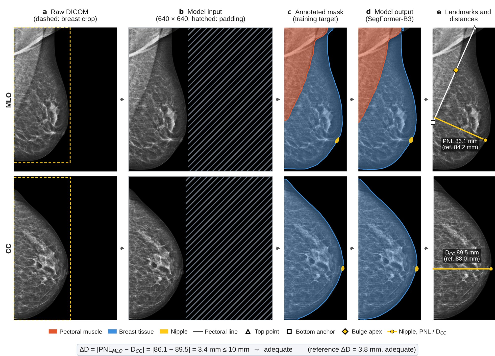</p>

<sub>From DICOM to decision on a held-out VinDr-Mammo pair. (a) DICOM after the VOI LUT, with the breast crop
(dashed). (b) Model input: the crop resized with its aspect ratio kept to a longer side of 640 pixels and
zero-padded to 640 × 640 (hatched). (c) The annotated mask. (d) The SegFormer-B3 output. (e) The landmarks and
distances derived from the output.</sub>

The segmentation route turns the masks into landmarks with a fixed rule:

- **Pectoral line (MLO).** The pectoral–breast boundary is traced row by row. The line runs through the outermost
  boundary point in the middle 10 % band of the muscle (the bulge apex) and the last boundary row (the bottom
  anchor). The curved upper part of the boundary is not used.
- **Nipple.** The centroid of the largest nipple component of the label map. When the label map has no nipple
  pixel, the nipple is the region where the model's nipple probability is at least 0.02, or failing that its most
  probable pixel, so every image gets a nipple.
- **CC distance.** The horizontal distance from the nipple to the chest-wall edge of the image.

<p align="center">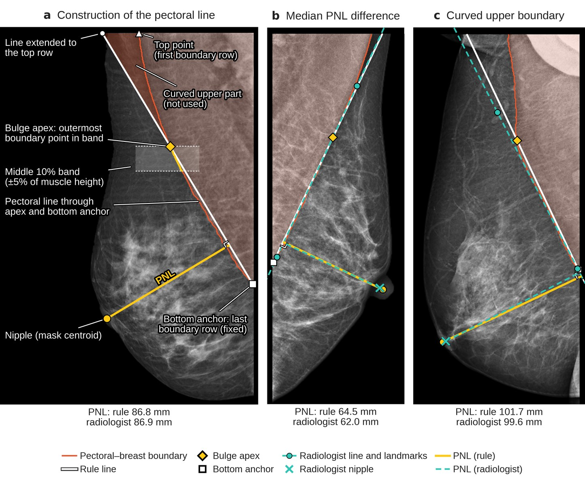</p>

<sub>The pectoral line rule on held-out VinDr-Mammo MLO views (SegFormer-B3): (a) construction, (b) a typical
case, (c) a curved upper boundary. Dashed lines are the radiologist's line and landmarks.</sub>

The landmark route predicts the same points directly with a YOLO26l-pose model per view.

<p align="center">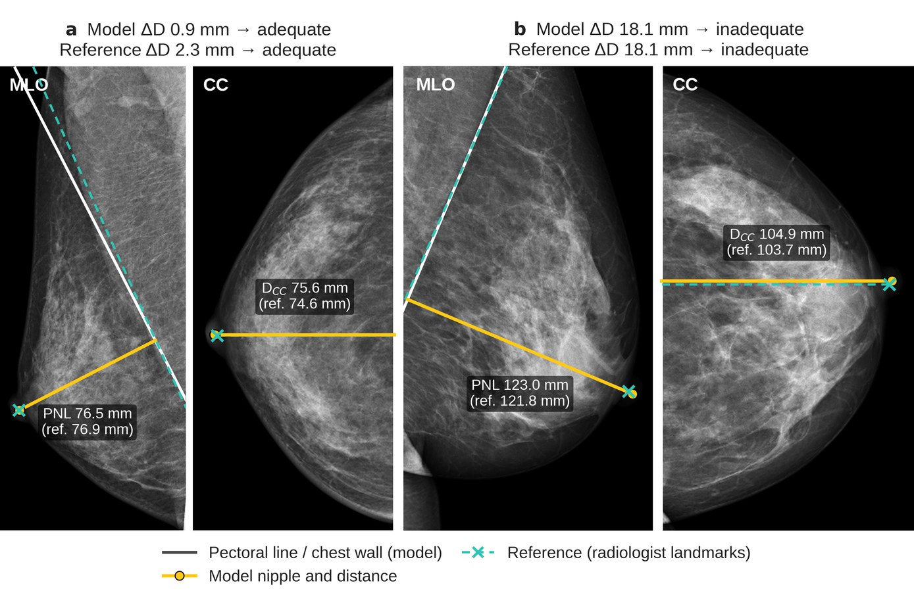</p>

<sub>An adequate pair (a) and an inadequate pair (b) from the held-out test. Solid lines show the model's
measurement; dashed lines and × show the radiologist reference.</sub>

### MLO-only quality

The same pectoral line and nipple also give a single-view check of the MLO image, which needs no CC view. It uses
the criterion of our MLO-only study (Denizoglu, Tanyel, Erkan et al., *Diagnostics* 2026;16(14):2262,
[doi:10.3390/diagnostics16142262](https://doi.org/10.3390/diagnostics16142262)): an MLO view is adequate when the
foot of the perpendicular from the nipple to the pectoral line lies inside the image. The margin is 0.25 % of the
longest image side, as in the [code released with that study](https://github.com/enescanerkan/deep-breast-positioning).
This is a separate rule from ΔD. The app shows it under each breast as *MLO quality: good / poor*.

<p align="center">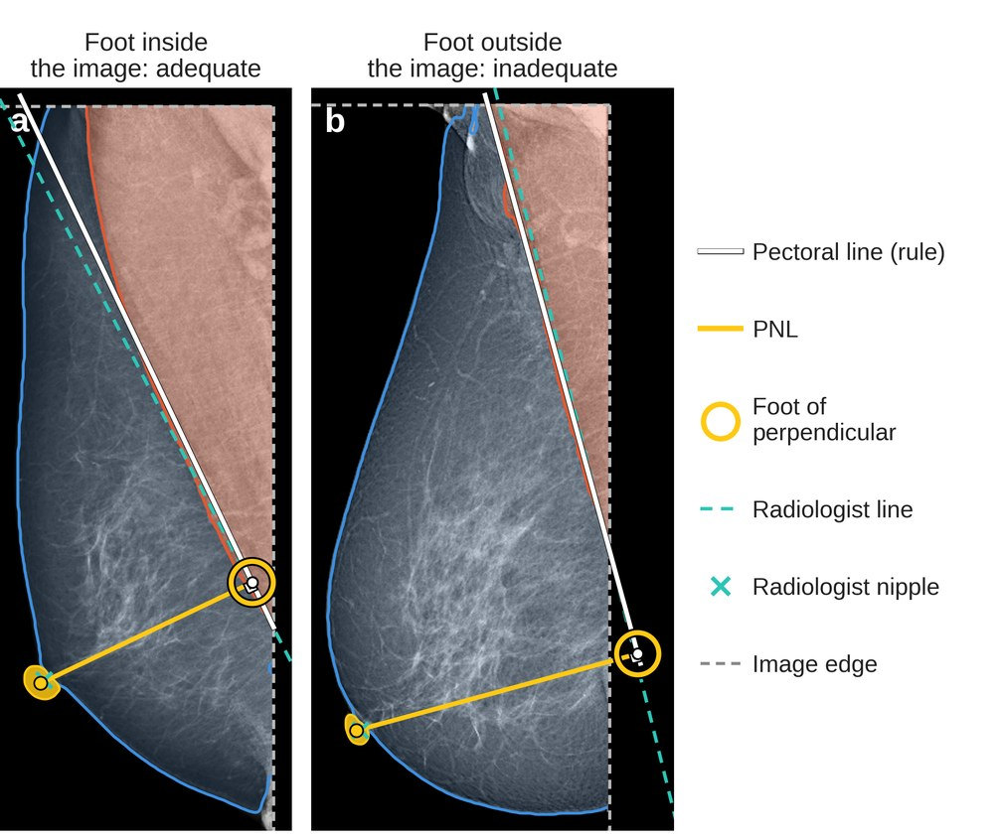</p>

<sub>The MLO-only criterion on two VinDr-Mammo MLO views (SegFormer-B3). (a) The foot of the perpendicular from
the nipple to the pectoral line (circled) lies inside the image: adequate. (b) It lies outside the image:
inadequate. The radiologist's pectoral line and nipple are shown for comparison.</sub>

## What is in the repository

| Part | What it does | Where |
|---|---|---|
| **Positioning review app** | Upload a study (DICOM folder or files). The app segments each view and places the landmarks. It measures the MLO PNL and the CC nipple-to-chest-wall distance, applies the ΔD rule, grades the MLO quality and writes an EN / TR report. Labels can be corrected in the browser, and the PNL can be adjusted by dragging its landmarks, with the measurement updated live. | `breast_seg.apps.positioning` · [docs/APP.md](docs/APP.md) |
| **Inference engine** | One registry of models (`configs/models.yaml`), the preprocessing recipes they were trained with, and a landmark engine usable from Python. | `breast_seg.inference`, `breast_seg.registry`, `breast_seg.imaging` |
| **Positioning geometry** | PNL, chest-wall distance, criteria and scoring, independent of any model. | `breast_seg.geometry`, `breast_seg.positioning` |
| **Dataset builder** | The 640 × 640 canvases and label maps of the VinDr-Mammo cohort, made from its DICOM files and the released labels, in the YOLO, semantic and nnU-Net layouts, with the held-out split, the 10 folds and an audit. | `breast_seg.datasets` · [docs/TRAINING.md](docs/TRAINING.md) |
| **Training** | One `Trainer` interface over SegFormer-B3, nnU-Net ResEnc-M, YOLO26m-seg and U-Net. YAML configs with inheritance and `--set` overrides. 10-fold cross-validation with out-of-fold merging. | `breast_seg.training` · [docs/TRAINING.md](docs/TRAINING.md) |
| **Evaluation** | Dice / IoU, landmark and distance errors in mm, the nipple and pectoral line rules, the ΔD decision, the MLO-only criterion, exact McNemar tests and bootstrap intervals. | `breast_seg.evaluation` · [docs/EVALUATION.md](docs/EVALUATION.md) |
| **Runtime benchmark** | End-to-end timing of a pair, from reading the DICOM files to the decision. | `breast_seg.benchmark` · [docs/BENCHMARK.md](docs/BENCHMARK.md) |
| **Annotation toolkit** | PyQt5 desktop app with three modes: MedSAM2 box / point prompting, manual polygon labelling with an optional detector, and a landmark-based positioning check. | `tools/annotation` · [README](tools/annotation/README.md) |
| **Labels** | Breast, pectoral muscle and nipple polygons of 2,926 VinDr-Mammo images (1,463 MLO–CC pairs); the external test sets (EMBED: radiologist landmarks and segmentation polygons; CMMD: radiologist landmarks). | `labels/` · [README](labels/README.md) |

## Quick start

### Windows app (no installation)

Download **`MammographyPositioning-windows-x64.zip`** from the
[v1.0.0 release](https://github.com/enescanerkan/mammography-segmentation/releases/tag/v1.0.0), unzip it and run
`MammographyPositioning.exe`. The app opens in its own window, runs on the CPU, needs no internet connection and
contains the landmark and segmentation weights. [docs/APP.md](docs/APP.md#windows-desktop-app) covers where studies
and settings are stored and how to build it yourself.

### 1. Weights

Weights are not part of the git history. They are published in the
[v1.0.0 release](https://github.com/enescanerkan/mammography-segmentation/releases/tag/v1.0.0): the two landmark
models, SegFormer-B3 (the default segmentation model), YOLO26m-seg and U-Net. `python packaging/weights.py weights`
downloads them into `weights/` and checks their SHA-256. Without the SegFormer-B3 folder the app serves YOLO26m-seg
instead (`/api/health` lists SegFormer-B3 under `skipped`). The layout, which `--weights` / `$BREAST_SEG_WEIGHTS` may
also point at:

```
weights/
  positioning/yolo26l_pose_mlo.pt      MLO landmarks        (required)
  positioning/yolo26l_pose_cc.pt       CC landmarks         (required)
  segmentation/segformer_b3/           segmentation         (SegFormer-B3, the default: config.json + model.safetensors)
  segmentation/yolo26m_seg.pt          segmentation         (YOLO26m-seg; selectable, stands in without SegFormer-B3)
  segmentation/unet.pt                 segmentation         (U-Net; selectable)
  medsam2/sam2_hiera_tiny.pt           SAM2 base            (annotation toolkit, from Meta's SAM2 release)
  medsam2/medsam_model_best.pth        MedSAM2 fine-tune    (annotation toolkit, not distributed)
```

The annotation toolkit reads the same folder, so one copy serves both.

### 2a. Docker (CPU, no Python setup)

```bash
docker compose up --build            # http://localhost:8000
WEIGHTS_DIR=/path/to/weights docker compose up
```

The port is bound to this machine only. `POSITIONING_HOST=0.0.0.0 docker compose up` opens it to the network; that
needs an authenticated proxy in front, because the app has no login. Studies are kept in the `positioning-data`
volume. Uploaded DICOM files are never written to disk: only the display renders and the label JSON are stored,
and they expire after 30 days by default.

### 2b. Python

```bash
pip install -c constraints.txt -e ".[app,models,dicom]"   # CPU is enough; a CUDA build of torch is used when present
breast-seg models                             # every model with "weights found" / MISSING
breast-seg serve --device cpu                 # http://127.0.0.1:8000
breast-seg serve --host 0.0.0.0 --port 8077 --device 0 --weights /path/to/weights
```

`constraints.txt` pins the library versions the measurements were validated with. OpenCV, NumPy and Ultralytics
releases move ΔD by a few tenths of a millimetre. The pins apply to Python 3.9–3.11, the versions the Docker image
and CI use. Without them the package still installs, with the newest libraries.

Settings live in an app config: threshold, retention, upload limits, the nipple steps and interface language. Copy
[`configs/app.example.yaml`](configs/app.example.yaml) and pass it with `--config`, or override single keys with
`--set rules.threshold_mm=12`.

### Using the models from Python

```python
from breast_seg.imaging import read_dicom
from breast_seg.inference import LandmarkEngine
from breast_seg.registry import Registry

engine = LandmarkEngine(Registry.load("configs/models.yaml"), device="cpu").load()
pixels, meta = read_dicom(open("L-MLO.dcm", "rb").read(), "L-MLO.dcm")
result = engine.analyse_landmarks(pixels, meta)   # nipple, pectoral line, masks as polygons, in original pixels
```

## Labels

[`labels/`](labels/README.md) holds the annotations of the study as CSV tables in the original DICOM pixel
coordinates, keyed by the DICOM `StudyInstanceUID` / `SOPInstanceUID`. The images are not included: they come from
the source databases under their own terms ([VinDr-Mammo on PhysioNet](https://physionet.org/content/vindr-mammo/1.0.0/)).

| Folder | Cohort | Content |
|---|---|---|
| `labels/vindr-mammo` | VinDr-Mammo, **1,463 MLO–CC pairs** from 827 studies (2,926 images) | breast, pectoral muscle and nipple polygons of every image; held-out split and cross-validation fold; the 640 × 640 canvas of every image |
| `labels/external` | EMBED (203 pairs) and CMMD (97 pairs) | radiologist landmarks and the reference positioning label of each pair; for EMBED also the breast, pectoral muscle and nipple polygons |

<p align="center">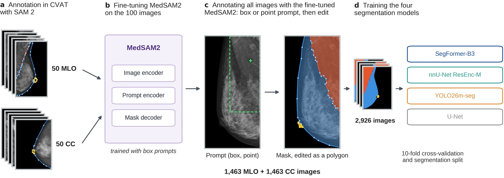</p>

<sub>How the masks were made. (a) 50 MLO and 50 CC images annotated in CVAT with SAM 2. (b) MedSAM2 fine-tuned on
these 100 images. (c) Every image of the cohort annotated with the fine-tuned model: a box or point prompt returns
a mask, which is corrected where needed. (d) The annotated images train the four segmentation models.</sub>

- **Polygons.** `mlo_segmentation_labels.csv` and `cc_segmentation_labels.csv` have one row per polygon
  (`labelName` = `Breast`, `Pectoral muscle`, `Nipple`; `data` = `{'vertices': [[x, y], ...]}`). The label map of
  an image (0 background, 1 pectoral muscle, 2 breast tissue, 3 nipple) is `Breast` filled with 2, then
  `Pectoral muscle` with 1, then `Nipple` with 3. `Split` gives the held-out split (Train / Validation / Test =
  1,186 / 131 / 146 pairs) and `Fold` the fold of the 10-fold cross-validation; both breasts of a study share both.
- **Canvas.** `canvas.csv` gives the crop, scale and padding of each image's 640 × 640 model input
  (`canvas_x = (dicom_x − crop_x1) × scale + pad_left`). `breast-seg build-dataset` reads the VinDr-Mammo DICOM files
  and these tables and writes the model canvases and the label maps of these annotations in the layouts of the four
  models ([Training and evaluation](#training-and-evaluation)).
- **Annotation.** All masks were drawn by one annotator, Enes Can Erkan. He annotated 50 MLO and 50 CC images in
  [CVAT](https://github.com/cvat-ai/cvat) with SAM 2 and fine-tuned MedSAM2 on them with box prompts. He then
  built an annotation tool around the fine-tuned model ([Annotation toolkit](#annotation-toolkit)) and annotated
  every image of the cohort with it: a box or point prompt returns a mask, which he corrected as a polygon where
  needed. The released polygons are cleaned and smoothed: each class keeps one connected region without holes, and
  on CC views the breast tissue reaches the chest-wall edge of the image.
- **Reference.** The masks serve as training targets and as the reference for the Dice coefficient. Every
  positioning measurement is compared with the landmarks placed by a board-certified breast radiologist: for the
  VinDr-Mammo pairs they are published with
  [mammography-positioning-yolo](https://github.com/enescanerkan/mammography-positioning-yolo/tree/main/data/labels),
  for the external test sets in `labels/external` (EMBED: landmarks and segmentation polygons; CMMD: landmarks).

<p align="center">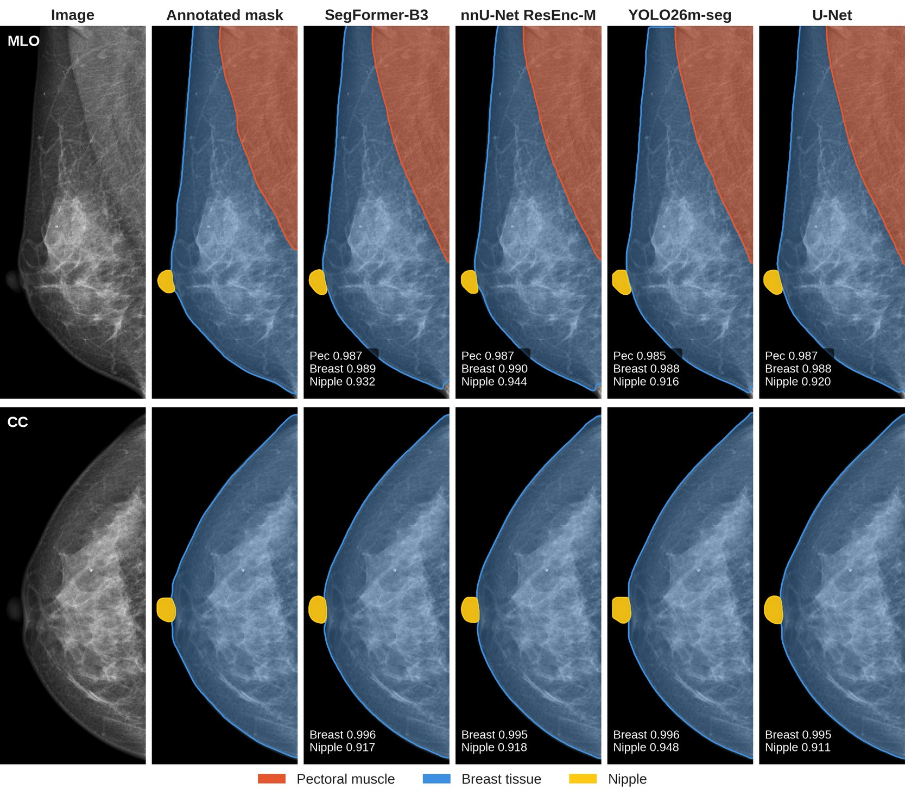</p>

<sub>A held-out pair: the annotated mask and the four segmentation models compared in the study, with per-image
Dice for each structure.</sub>

## Models

| Model | Role | Architecture | Input → output | Parameters |
|---|---|---|---|---|
| SegFormer-B3 | segmentation (proposed in the study; the app's default) | MiT-B3 hierarchical transformer + all-MLP decoder | 3 × 640 × 640 → 4 × 640 × 640 | 47.2 M |
| nnU-Net ResEnc-M | segmentation (compared in the study) | residual-encoder U-Net, 2D, 7 stages | 1 × 640 × 640 → 4 × 640 × 640 | 105.9 M |
| YOLO26m-seg | segmentation (compared in the study; selectable in the app) | YOLO26 backbone, FPN / PAN neck, instance-mask head | 3 × 640 × 640 → instances with masks | 27.0 M |
| U-Net | segmentation baseline (compared in the study) | plain U-Net, 4 levels, trained from scratch | 1 × 640 × 640 → 4 × 640 × 640 | 31.0 M |
| YOLO26l-pose, MLO and CC | landmark route of the app | YOLO26 backbone, FPN / PAN neck, pose head | 3 × 640 × 640 → breast box + keypoints (MLO 3, CC 1) | 27.9 M each |
| MedSAM2 | box-prompted masks in the annotation toolkit | SAM2 Hiera-tiny, fine-tuned mask decoder | 1024 × 1024 image + box → 256 × 256 mask | 31.4 M used |

Training recipes, the dataset and the weight files are in [docs/MODELS.md](docs/MODELS.md).

The figures below are drawn by [`tools/figures/architectures.py`](tools/figures/architectures.py). Tensor shapes
were measured with forward hooks on a 640 × 640 input (channels × height × width); parameter counts come from the
checkpoints and the configurations of the trained models.

<details open>
<summary><b>SegFormer-B3</b></summary>

<picture>
  <source media="(prefers-color-scheme: dark)" srcset="docs/figures/architectures/segformer_b3_dark.svg">
  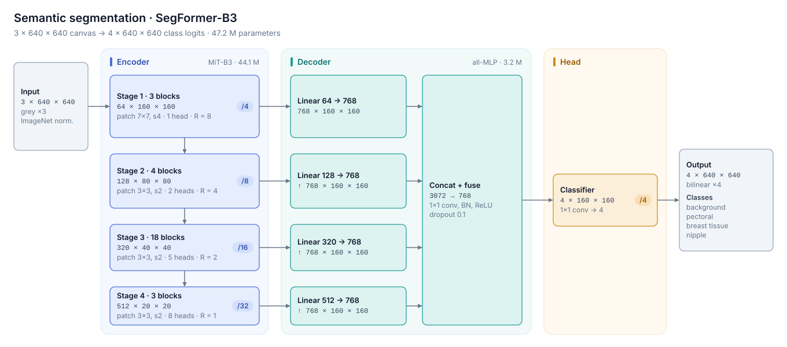
</picture>

<sub>A hierarchical MiT-B3 transformer encoder (depths 3-4-18-3, efficient self-attention with spatial reduction R, Mix-FFN) and an all-MLP decoder that projects every stage to 768 channels at 1/4 resolution, concatenates and fuses them. A 1 × 1 classifier gives the 4-class logits, upsampled bilinearly to the canvas.</sub>
</details>

<details>
<summary><b>nnU-Net ResEnc-M (2D)</b></summary>

<picture>
  <source media="(prefers-color-scheme: dark)" srcset="docs/figures/architectures/nnunet_resenc_m_dark.svg">
  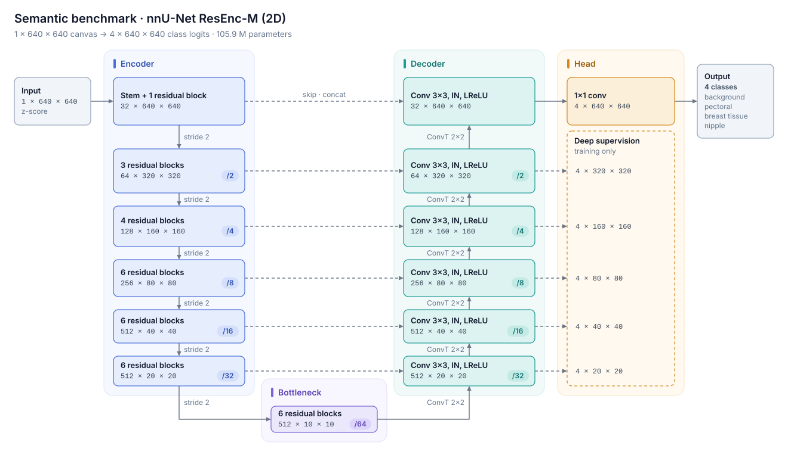
</picture>

<sub>nnU-Net v2 residual-encoder U-Net from the 2D plans of the trained model. Residual blocks of (3 × 3 conv, InstanceNorm, LeakyReLU) × 2 with a shortcut; the first block of each stage has stride 2. The decoder uses 2 × 2 transposed convolutions and concatenated skips. Outputs at every decoder level give deep supervision in training; only the full-resolution output is used at inference.</sub>
</details>

<details>
<summary><b>YOLO26m-seg</b></summary>

<picture>
  <source media="(prefers-color-scheme: dark)" srcset="docs/figures/architectures/yolo26m_seg_dark.svg">
  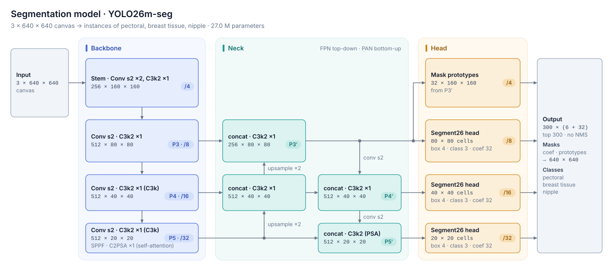
</picture>

<sub>A CSP backbone and an FPN / PAN neck. Each cell predicts a box, 3 class scores and 32 mask coefficients; the instance mask is the coefficients times 32 prototype masks (sigmoid, cropped to the box, resized to 640 × 640). The top 300 instances are kept without NMS.</sub>
</details>

<details>
<summary><b>U-Net</b></summary>

<picture>
  <source media="(prefers-color-scheme: dark)" srcset="docs/figures/architectures/unet_dark.svg">
  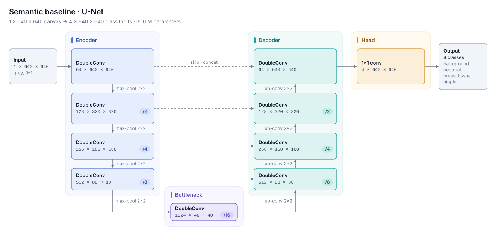
</picture>

<sub>The plain U-Net baseline, trained from scratch: (3 × 3 conv, BatchNorm, ReLU) × 2 per level, 2 × 2 max-pool down, 2 × 2 transposed convolution up, concatenated skips and a 1 × 1 convolution to the 4-class logits. No attention, residual blocks or pre-training.</sub>
</details>

<details>
<summary><b>YOLO26l-pose (landmarks, MLO and CC)</b></summary>

<picture>
  <source media="(prefers-color-scheme: dark)" srcset="docs/figures/architectures/yolo26l_pose_dark.svg">
  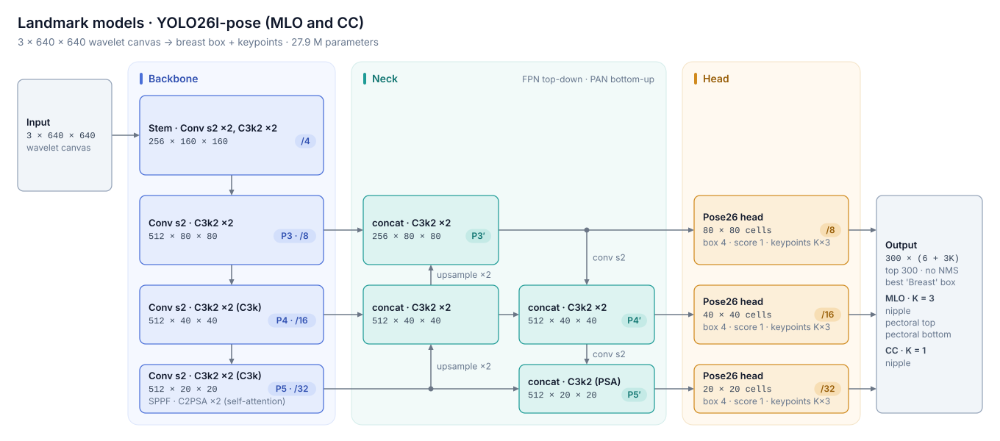
</picture>

<sub>The same backbone and neck at l scale with three pose heads (strides 8 / 16 / 32) that predict a box, a score and K keypoints per cell. The keypoints are read from the best breast box: MLO K = 3 (nipple, pectoral top, pectoral bottom), CC K = 1 (nipple).</sub>
</details>

<details>
<summary><b>MedSAM2 (annotation toolkit)</b></summary>

<picture>
  <source media="(prefers-color-scheme: dark)" srcset="docs/figures/architectures/medsam2_dark.svg">
  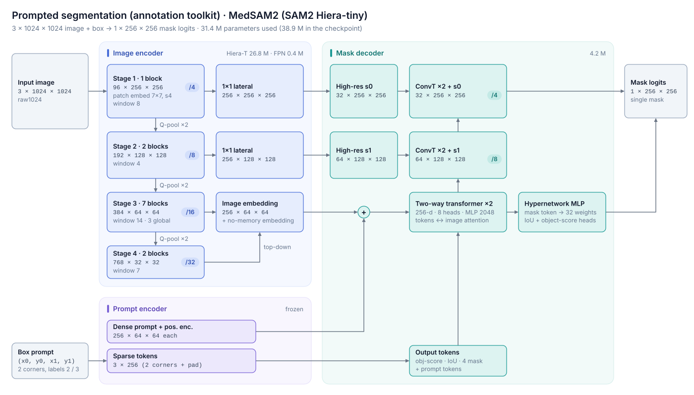
</picture>

<sub>SAM2 Hiera-tiny fine-tuned for box prompts. The Hiera trunk and its FPN neck give a 64 × 64 image embedding plus two high-resolution levels; the frozen prompt encoder turns the box into two corner tokens; the mask decoder (two-way transformer, upscaling, hypernetwork MLP) returns one 256 × 256 mask. The image encoder and the mask decoder were trained; the video memory modules are not used.</sub>
</details>

## Training and evaluation

```bash
pip install -e ".[models,train,dicom]"                 # + ".[segformer]" / ".[nnunet]" for those families
cp configs/paths.example.yaml configs/paths.yaml       # local paths live only here (git-ignored)

breast-seg build-dataset --dicom-root <VinDr-Mammo images> --workers 8          # -> <data_root>/vindr
breast-seg train configs/train/segformer_b3.yaml --set device=0
breast-seg predict configs/train/segformer_b3.yaml --split test      # -> outputs/predictions/segformer_b3_test
breast-seg evaluate --config configs/cv/cv10_segformer_b3.yaml --preds outputs/predictions/segformer_b3_test \
    --set pairs_split=Test --out outputs/results --name segformer_b3_test
breast-seg export configs/train/segformer_b3.yaml          # -> <weights_dir>/segmentation/segformer_b3
breast-seg cv configs/cv/cv10_segformer_b3.yaml            # train, predict out-of-fold, merge, evaluate
```

One training config per model (`configs/train/`: `segformer_b3`, `nnunet_resenc_m`, `yolo26m_seg`, `unet`) and one
cross-validation config per model (`configs/cv/`). The evaluation compares every measurement with the radiologist
landmarks of [mammography-positioning-yolo](https://github.com/enescanerkan/mammography-positioning-yolo/tree/main/data/labels)
(paths in `configs/paths.yaml`). See [docs/TRAINING.md](docs/TRAINING.md) and [docs/EVALUATION.md](docs/EVALUATION.md).

`breast-seg benchmark runtime` times a pair end to end, from reading the DICOM files to the adequacy decision, for
every pipeline in one process with a rotating order. The protocol, the commands and the output files are in
[docs/BENCHMARK.md](docs/BENCHMARK.md).

## Annotation toolkit

```bash
pip install -e ".[annotation,models,dicom]"
python tools/annotation/app.py
```

The launcher has three modes:

- **SAM Label**: MedSAM2 box / point prompts, refined as polygons. The segmentation masks above were made in
  this mode.
- **Manual Label**: polygons and boxes, with an optional one-click detector.
- **Breast Positioning**: landmarks on an MLO + CC pair with a live PNL / chest-wall overlay.

Labels are saved in YOLO segmentation format. Details are in
[tools/annotation/README.md](tools/annotation/README.md).

## Development

```bash
pip install -c constraints.txt -e ".[app,models,segformer,dicom,train,dev]"
pytest                                              # package tests
QT_QPA_PLATFORM=offscreen pytest tools/annotation/tests
ruff check src tests tools
```

Tests that need the real weights are marked `weights` and skip themselves when the files are absent.

## Notes and license

Research software, not a medical device: every measurement must be checked by a reader. The interface is English
by default with a Turkish switch.

Code and labels: MIT, see [LICENSE](LICENSE). The vendored [Tabler](https://tabler.io) stylesheet is MIT-licensed
as well. The images the labels belong to are distributed by VinDr-Mammo (PhysioNet), CMMD (TCIA) and EMBED, each
under its own terms.
